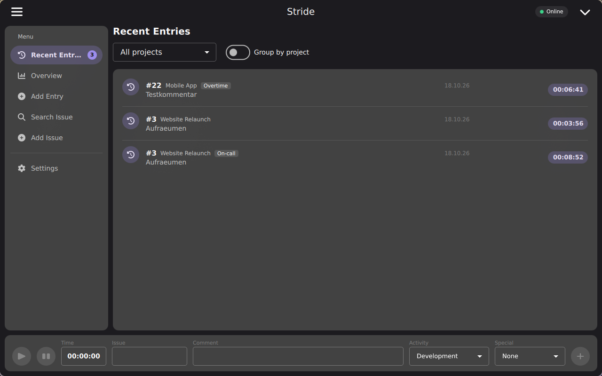
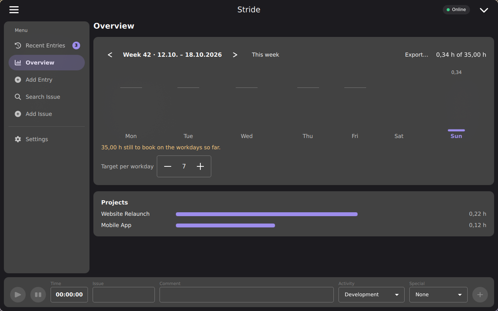
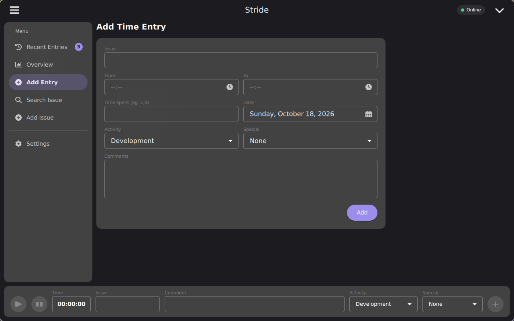
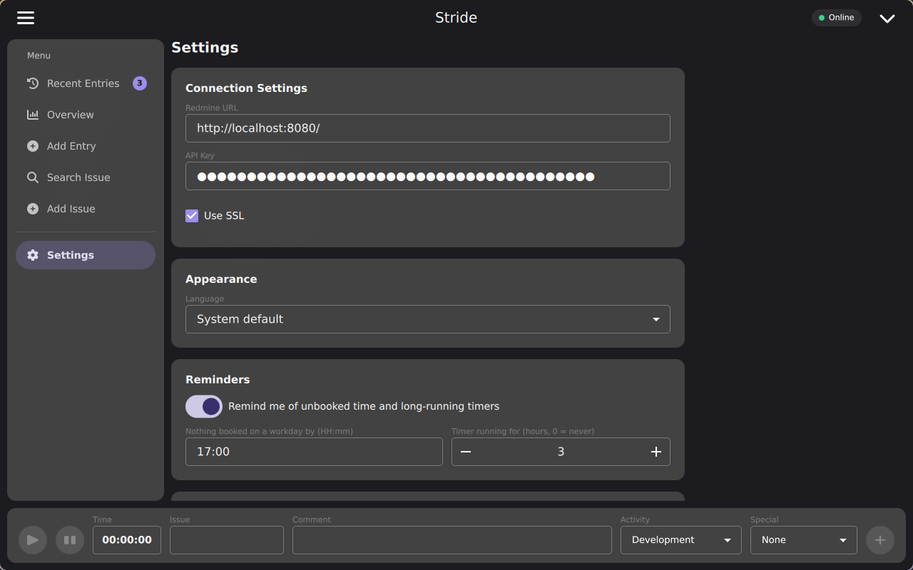
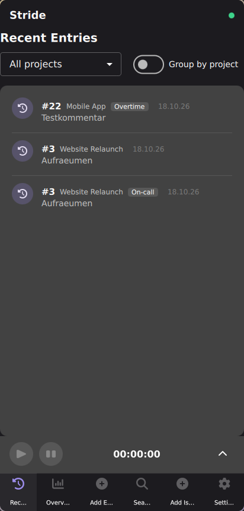
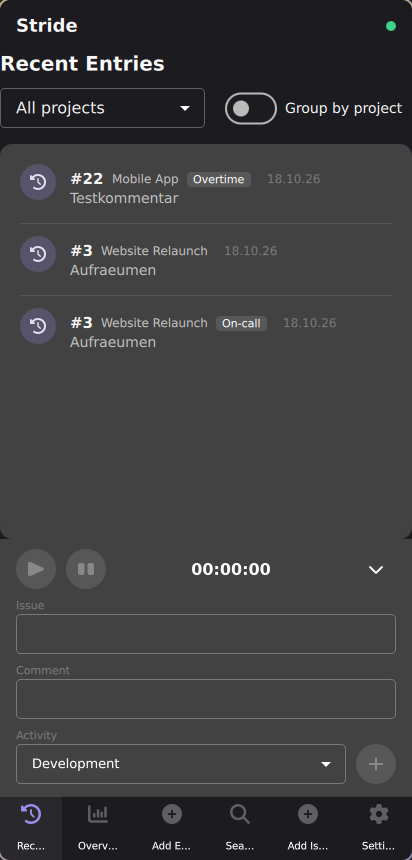

# Stride

A desktop application built with Qt 6 for tracking time spent on Redmine issues, for Linux and Windows, with a dedicated portrait UI for Android and iOS. Features automatic time tracking, offline support, and seamless integration with Redmine's REST API.

📖 **Documentation:** <https://drook207.github.io/stride/> - getting started, a full
user guide, and developer docs (sources in [docs/](docs/)).

⬇️ **Download:** the Windows and Linux installers are attached to the
[latest release](https://github.com/drook207/stride/releases/latest).

## Screenshots

| Recent entries                                                        | Week overview                                                  |
| --------------------------------------------------------------------- | -------------------------------------------------------------- |
|  |  |
| **Add time entry**                                                    | **Settings**                                                   |
|  |       |

| Mobile                                                                                                | Mobile, tracking panel expanded                                                                                   |
| ----------------------------------------------------------------------------------------------------- | ----------------------------------------------------------------------------------------------------------------- |
|  |  |

See the [User Guide](https://drook207.github.io/stride/user-guide/) for a walkthrough of every view, on both desktop and mobile.

## Features

### Time Tracking

- Start/Stop/Pause functionality with real-time elapsed time display
- The running timer survives closing the app or a crash; time the app was gone or the computer
    was asleep can be counted or left out
- Continue an earlier entry's work with one click, and pin favorite issues for quick access
- Set the issue's status (e.g. to "Resolved") when submitting time
- Keyboard shortcuts: Ctrl+Space (start/pause/resume), Ctrl+Enter (submit), Ctrl+1 .. Ctrl+6 (views)
- System tray icon with pause/resume and favorites, optionally keeping the app running when the
    window is closed
- Reminders of a workday without booked time and of long-running timers

### Overview and Export

- Week overview: hours per day against a daily target, hours still missing, and hours per project
- Export the time entries of a period as CSV (for spreadsheets) or PDF

### Redmine Integration

- Full issue and project management (create, update, list, delete)
- Create, update, and delete time entries directly from the app
- View and manage existing time entries, with activities and the "Special" custom field
- Add Issue offers only the projects you may add issues to
- API key stored in the OS-native secure storage (e.g. Windows Credential Manager, Secret Service/KWallet on Linux, the Keychain on Apple platforms, the Android Keystore) - never in plain text
- Automatic Redmine REST API version detection, so newer features can be gated on server capability
- Error handling, connection-state indicator, and retry mechanisms

### Offline Support

- Time entries are saved locally first and sent to Redmine when it's reachable - right away, or
    once the connection comes back
- Entries Redmine rejects are marked with the reason and sent again once changed
- SQLite database with versioned schema migrations, in the platform's application data directory

### Logging

- Structured log (JSON Lines) of every Redmine request, connection change and tracking event, in
    rotating files - see [Logging](https://drook207.github.io/stride/development/logging/)
- Log level, log view, log folder and log export in the settings

### Localization

- Available in English and German, selected automatically from the system locale
- More languages can be added via the Qt Linguist `.ts` files in [src/Stride/i18n](src/Stride/i18n) - see that directory's README for the workflow

## Requirements

- Qt 6.8 or higher
- CMake 3.16 or higher (3.25+ to use the provided CMake Presets)
- C++17 compatible compiler
- SQLite
- Linux, or Windows with MSVC or MinGW
- Internet access on first configure - GoogleTest and [QtKeychain](https://github.com/frankosterfeld/qtkeychain) are fetched automatically via CMake `FetchContent`

## Building

Building uses the CMake Presets in `CMakePresets.json`:

```bash
git clone https://github.com/drook207/stride.git
cd stride

# Point at your Qt installation, e.g. .../Qt/6.8.0/gcc_64 (Linux),
# .../Qt/6.8.0/msvc2022_64 or .../Qt/6.8.0/mingw_64 (Windows)
export QT_DIR=/path/to/Qt/6.x.y/<kit>

cmake --preset linux-debug
cmake --build --preset linux-debug
```

The app is then at `build/linux-debug/src/Stride/Stride`.

Run `cmake --list-presets` for the full list - `linux-{debug,release,relwithdebinfo}`,
`windows-msvc-{debug,release,relwithdebinfo}` (run from an _x64 Native Tools Command
Prompt for VS_, or after calling `vcvarsall.bat x64`, so `cl.exe` is on `PATH`), and
`windows-mingw-{debug,release,relwithdebinfo}`. Only the presets matching your current
OS are shown.

## Testing

Unit and integration tests (GoogleTest) live in `tests/`. Build and run them directly:

```bash
cmake --build --preset linux-debug --target stride-tests
./build/linux-debug/tests/stride-tests
```

They cover the Redmine client and the app's storage and tracking logic (on an in-memory
database). GitHub Actions ([.github/workflows/ci.yml](.github/workflows/ci.yml)) runs them for every pull
request and on `main`, together
with the pre-commit hooks and qmllint, which must report no warnings:

```bash
cmake --build --preset linux-debug --target all_qmllint
```

For manual testing against a real server, a disposable local Redmine instance
(with demo projects/issues/users/time entries) is available via Docker - see
[docker/README.md](docker/README.md).

## Configuration

1. Launch the application
2. Enter your Redmine URL in the settings
3. Add your API key from Redmine - it's written straight to the OS-native secure storage,
    never persisted in plain text
4. (Optional) Configure default activity types

## Usage

1. Enter an issue ID
2. Click "Start Tracking" to begin timing
3. Use Pause/Resume as needed
4. Add comments about the work done
5. Stop tracking when finished
6. Time entry will be saved locally and synced to Redmine

## Database Schema

Time entries are stored in SQLite with the following structure:

- `id`: Primary key
- `issue_id`: Redmine issue identifier
- `hours`: Time spent in decimal hours
- `comments`: Work description
- `spent_on`: Date/time of work
- `sync_status`: Synchronization state
- `redmine_id`: ID from Redmine after sync
- `created_at`: Local creation timestamp
- `updated_at`: Last modification timestamp

## Documentation

The documentation website is built with MkDocs from [docs/](docs/) and published on GitHub Pages from
`main` - see [Working on the documentation](https://drook207.github.io/stride/development/contributing/#working-on-the-documentation)
to preview it locally.

## Contributing

1. Fork the repository
2. Create a feature branch
3. Install the pre-commit hooks: `pip install pre-commit && pre-commit install`
    (runs clang-format/clang-tidy/cppcheck/cmake-format/mdformat/codespell/markdownlint, and enforces
    [Conventional Commits](https://www.conventionalcommits.org) on commit messages)
4. Commit your changes
5. Push to the branch
6. Create a Pull Request

## License

This project is licensed under the MIT License - see the [LICENSE](LICENSE) file for details.

The app uses and ships third-party software under other licenses - Qt under the LGPL-3.0,
QtKeychain under BSD-3-Clause, and Font Awesome icons and font under CC BY 4.0 and OFL-1.1. See
[THIRD_PARTY_NOTICES.md](THIRD_PARTY_NOTICES.md) and the license texts in [LICENSES/](LICENSES/).
