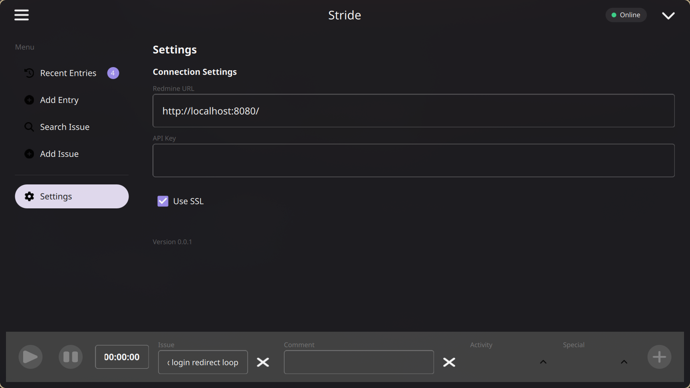
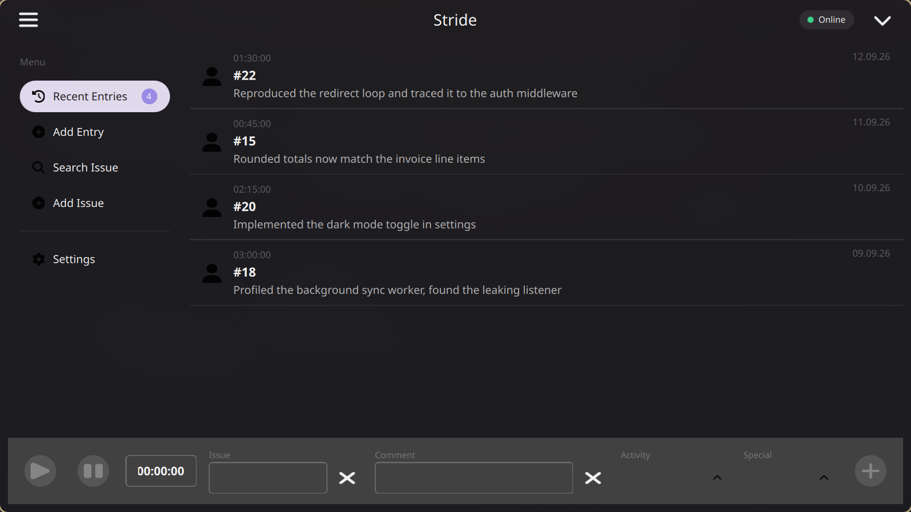
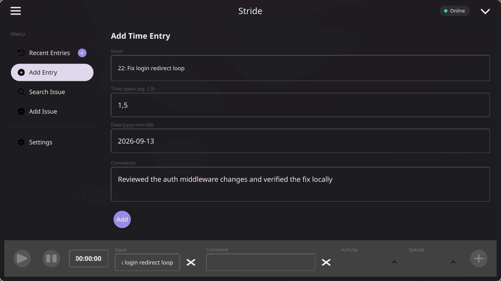
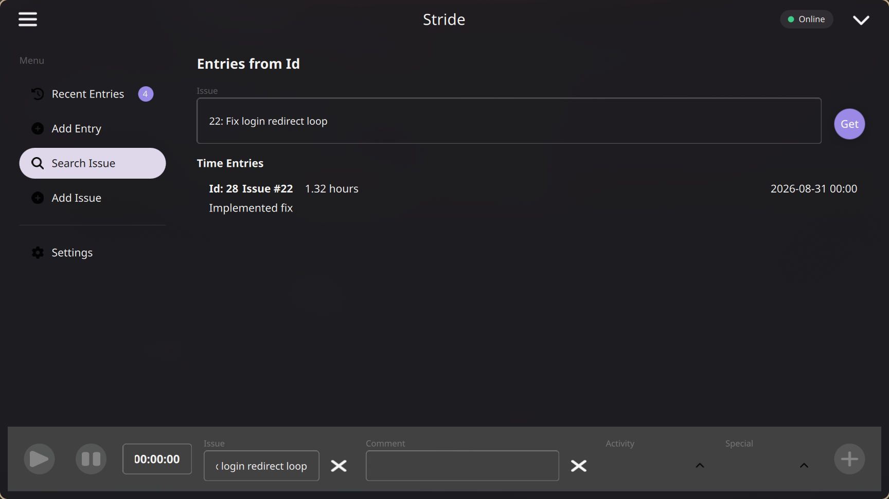
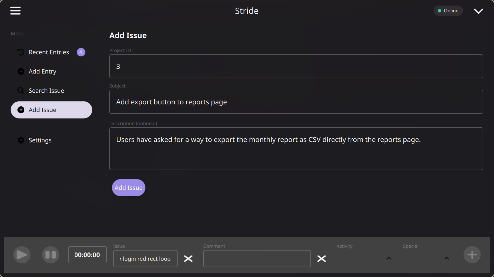
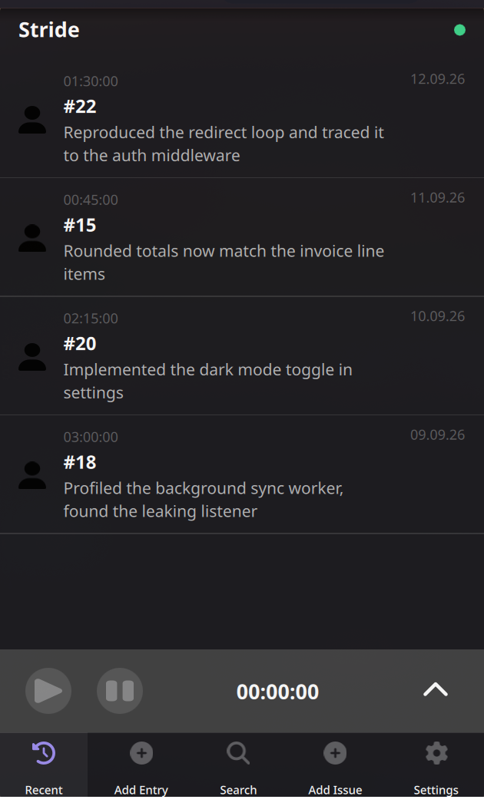
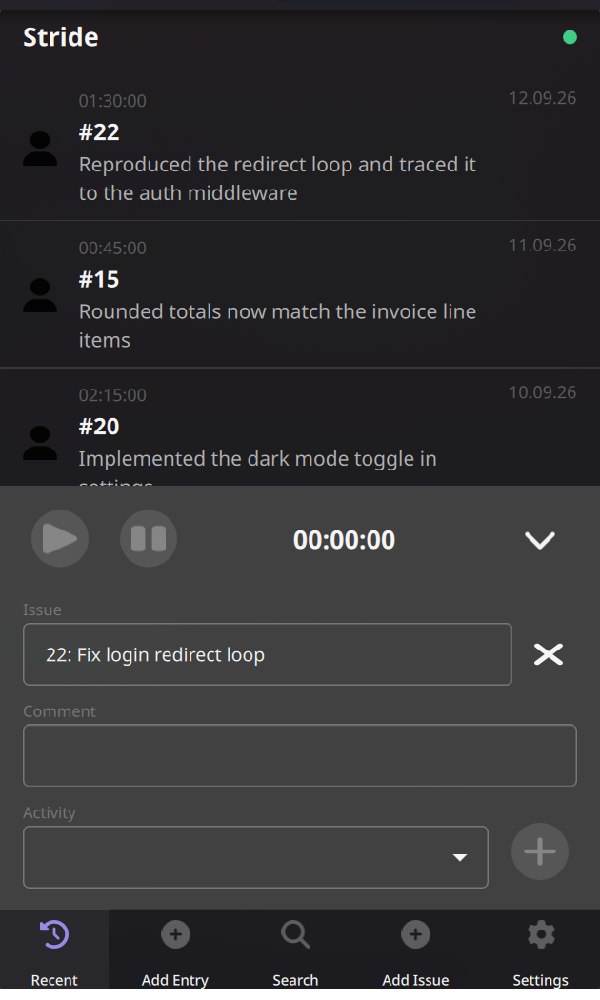

# User Guide

A walkthrough of Stride (QRedmineTimeTracker)'s desktop and mobile UI, with
screenshots of every view. For build instructions, see the main
[README](../README.md).

## First launch: connecting to Redmine

Open **Settings** from the sidebar and fill in:

1. **Redmine URL** - the base URL of your Redmine instance, e.g.
   `https://redmine.example.com/`
2. **API Key** - found on your Redmine account page under *My account ->
   API access key*. It's written straight to the OS-native secure storage
   (Windows Credential Manager, Linux Secret Service/KWallet) and never
   persisted in plain text.
3. **Use SSL** - enable this if your Redmine URL uses `https://`.

The connection indicator next to the app title reflects the live state:
green (**Online**), amber (**Reconnecting**), or red (**Offline**).

## Recent entries

The default view lists your locally tracked time entries, newest first -
issue number, duration, comment, and date. The badge on **Recent Entries**
in the sidebar shows how many entries are stored locally.

## Tracking time

The control bar at the bottom of the window is always visible, regardless
of which view is open:

1. Enter or search for an issue in the **Issue** field.
2. Press the play button to start tracking. It's enabled once a known,
   valid issue is selected.
3. Use pause/resume as needed - the elapsed time keeps counting while
   tracking is active.
4. Add a **Comment** and pick an **Activity**, then press the **+** button
   to submit. You'll be asked to confirm before the entry is saved locally
   and synced to Redmine.

Time tracked while offline is queued locally and synced automatically once
the connection is restored.

## Adding a time entry manually

Use **Add Entry** in the sidebar to log time without using the live
tracker - useful for backfilling work done earlier.

## Looking up time entries for an issue

**Search Issue** fetches every time entry already logged against a given
issue directly from Redmine, so you can check what's already been
recorded before adding more.

## Creating a new issue

**Add Issue** creates a new Redmine issue from inside the app - handy when
you start work on something that doesn't have a ticket yet.

## Mobile UI (Android / iOS)

On Android and iOS, Stride switches to a portrait-first layout: a
simplified header, a full-width view area, a collapsible tracking panel,
and a bottom navigation bar instead of the desktop sidebar.

Tapping the chevron on the tracking bar expands it to reveal the same
issue, comment, and activity fields as the desktop tracking bar, without
crowding the screen the rest of the time.

