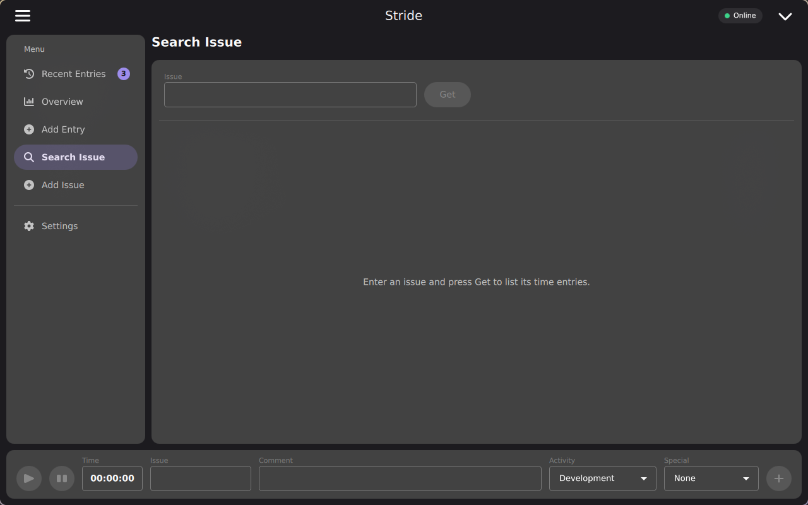
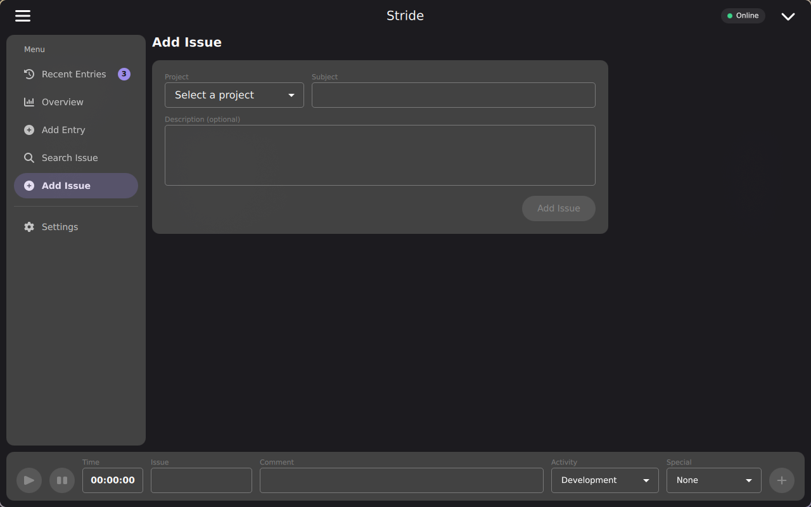

# User guide

A walkthrough of Stride's desktop and mobile UI. To install the app and
connect it to Redmine, see [Getting started](getting-started.md).

## The main window

The desktop window has three parts:

- the **sidebar** on the left, which switches between the views (the menu
    button in the header collapses it),
- the current **view** in the middle,
- the **tracking bar** at the bottom, which stays visible in every view.

The header also shows the connection state: green **Online**, amber
**Reconnecting** or red **Offline**.

## Tracking time

The tracking bar holds everything needed to track the issue you're working
on:

1. Enter an issue number, or type to search for an issue, in the **Issue**
    field. Play is enabled once a known issue is selected.
2. Press play to start the timer. Pause and resume as needed - the **Time**
    field shows the elapsed time.
3. Add a **Comment**, choose an **Activity** and, if your Redmine has the
    *Special* time entry field, a **Special** value.
4. Press **+** to submit. The confirmation dialog shows the total time and
    lets you set a new **issue status** (e.g. *Resolved*) along with the
    entry; *Unchanged* leaves the issue as it is.

The running timer is saved continuously, so it survives closing the app or a
crash. When the computer wakes up from sleep while a timer was running,
Stride asks whether the time asleep should count (**Count it**) or not
(**Leave it out**). When you start the app again with a timer still running,
it asks whether the time since you last used it should count (**Count it**),
or whether the timer should end at that point (**Stop it then**).

## Recent entries

The default view lists the time entries tracked in the app, newest first,
with issue, project, comment, date and duration. The badge in the sidebar
shows how many there are.

- **Filter** the list by project, or **group** it by project.
- **Continue** an earlier entry: hover it and press play to start tracking
    the same issue, comment and activity again.
- **Pin** an issue with the star. Pinned issues show up as buttons above the
    list and in the tray menu, and start tracking with one click.
- **Edit or delete** an entry by clicking it. Deleting an entry that is
    already on Redmine deletes it there, too.

Entries that haven't reached Redmine yet are marked. Entries Redmine
rejected show the reason, and are sent again once you change them.

## Overview

The overview shows a week at a time: the hours booked per day against your
daily target, the hours still missing on the workdays so far, and the hours
per project. Use the arrows to move between weeks and **This week** to jump
back. Change the target with **Target per workday**.

If Redmine can't be reached, the overview counts only the entries saved in
the app, and says so.

### Exporting time entries

**Export…** in the overview exports the time entries of a period - from and
to any date - as a **CSV** file for spreadsheets, or as a **PDF** report.

## Adding a time entry manually

**Add Entry** logs time without the live timer, for example to backfill work
done earlier. Enter either a **From**/**To** range or the **Time spent**, and
pick the date, activity and comment.

## Looking up the time entries of an issue

**Search Issue** fetches every time entry already logged on an issue directly
from Redmine - handy to check what's already been booked. You can continue,
pin, edit and delete these entries just like recent ones.

## Creating an issue

**Add Issue** creates a Redmine issue from inside the app, for work that
doesn't have a ticket yet. The project list only offers the projects you're
allowed to add issues to.

## Settings

- **Connection Settings** - Redmine URL, API key and SSL, see
    [Getting started](getting-started.md#connect-to-redmine).
- **Appearance** - the UI language. *System default* follows the system
    locale; changes apply immediately.
- **Reminders** - remind you when nothing is booked on a workday by a given
    time, and when a timer has been running for a given number of hours
    (0 turns that off).
- **System tray** - keep the app running in the tray when the window is
    closed.

## System tray

Where the platform offers a system tray, Stride shows an icon with the
tracked issue and elapsed time. Its menu pauses and resumes the timer, starts
tracking a pinned issue, shows the window and quits the app.

## Working offline

Every time entry is saved in the app first and then sent to Redmine - right
away when it's reachable, otherwise as soon as the connection comes back. You
can keep tracking and editing entries while offline.

## Keyboard shortcuts

| Shortcut                | Action                                                       |
| ----------------------- | ------------------------------------------------------------ |
| ++ctrl+space++          | Start, pause or resume the timer                             |
| ++ctrl+enter++          | Submit the tracked time                                      |
| ++ctrl+1++ … ++ctrl+5++ | Recent Entries, Overview, Add Entry, Search Issue, Add Issue |
| ++ctrl+6++              | Settings                                                     |

## Mobile UI (Android and iOS)

On Android and iOS, Stride uses a portrait layout: a compact header, the
view in full width, a collapsible tracking panel, and a bottom navigation bar
instead of the sidebar.

{ width="320" }

The chevron on the tracking panel expands it to show the issue, comment and
activity fields, and keeps them out of the way the rest of the time.

{ width="320" }
